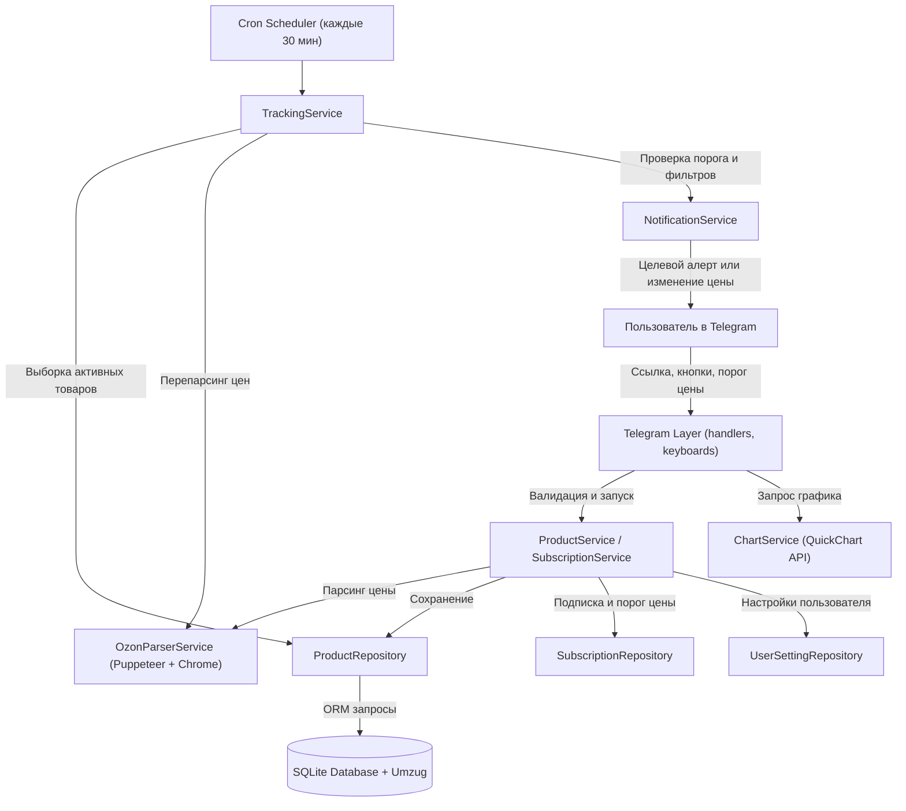

# 📋 PLAN.md — План проекта Ozon Price Tracker Bot

> [!NOTE]
> В данном файле зафиксирована общая архитектура, текущее состояние проекта, реализованные этапы и карта дальнейшего развития (Roadmap).

---

## 🎯 Цель проекта
Создание надежного, модульного Telegram-бота для мониторинга цен на товары маркетплейса **Ozon**. Бот позволяет пользователям отправлять ссылки на товары, сохраняет их в базу данных, с помощью Puppeteer и Google Chrome регулярно (каждые 30 минут) парсит цены (включая специальную цену по Ozon Карте) и присылает детальные алерты при любых изменениях стоимости.

---

## 🏗️ Архитектура системы

---

## 📊 Статус реализации этапов

### ✅ Этап 1: Парсинг Ozon товаров через Puppeteer
- [x] Подключение `puppeteer-extra` и плагина `puppeteer-extra-plugin-stealth`.
- [x] Автоопределение бинарника Google Chrome (`/usr/bin/google-chrome`).
- [x] Извлечение цены по Ozon Карте (зеленый бейдж, например `1 440 ₽`).
- [x] Извлечение регулярной цены без карты (например `1 516 ₽`).
- [x] Извлечение названия, фото и статуса наличия.
- [x] Поддержка прокси-серверов с авторизацией (`PROXY_URL`).
- [x] Демо-режим для отладки без внешних сетевых блокировок.

### ✅ Этап 2: Полноценная ORM и поддержка миграций
- [x] Подключение ORM **Sequelize** (диалект SQLite).
- [x] Инструмент версионирования миграций **Umzug** с фиксацией в `SequelizeMeta`.
- [x] Миграции структуры таблиц `products`, `subscriptions`, `price_history`.
- [x] Хранение даты последнего парсинга (`last_parsed_at`) в таблице `products`.
- [x] Автоматическое применение миграций при запуске (`initDb()`).

### ✅ Этап 3: Слой Репозиториев (Repository Pattern)
- [x] Создание `BaseRepository`, `productRepository`, `subscriptionRepository`, `priceHistoryRepository`.
- [x] Полная изоляция ORM и SQL: сервисы и контроллеры не делают прямых запросов к БД.
- [x] Автоматическая запись снимка цены в `price_history` при каждом изменении стоимости.

### ✅ Этап 4: Слой Сервисов (Бизнес-логика)
- [x] `productService`: валидация ссылок, парсинг, сохранение и привязка к клиенту.
- [x] `subscriptionService`: подписка, отписка, списки подписчиков.
- [x] `trackingService`: фоновый запуск проверки каждые 30 минут (`*/30 * * * *`).
- [x] `notificationService`: рассылка алертов пользователям в Telegram.

### ✅ Этап 5: Модульный Telegram-бот (Telegraf)
- [x] Разделение хэндлеров: команды (`commandHandlers.js`), сообщения (`messageHandlers.js`), кнопки (`actionHandlers.js`).
- [x] Команды: `/start`, `/help`, `/list` (список отслеживаемых товаров с кнопками), `/check` (ручной запуск проверки).
- [x] Отображение даты последнего парсинга в карточках товаров.

### ✅ Этап 6: Тестирование и документация
- [x] Покрытие сквозными интеграционными тестами (`test/testParser.js`).
- [x] Создание главного файла правил: [`GLOBAL.md`](file:///home/fulliton/work/tg-shopper-bot/GLOBAL.md).
- [x] Создание файлов `AGENT.md` в каждой папке проекта.

### ✅ Этап 7: Желаемая цена (Price Target Alerts)
- [x] Миграция `20261101000004-add-target-price-and-user-settings.js`: добавление поля `target_price` в таблицу `subscriptions`.
- [x] Методы в `subscriptionRepository`: `setTargetPrice()`, `clearTargetPrice()`, `getSubscriptionsWithDetails()`.
- [x] Интерактивный ввод порога цены через кнопку «🎯 Задать порог» и распознавание суммы в чате.
- [x] Специальное акцентное уведомление `🎉 🎯 ЖЕЛАЕМАЯ ЦЕНА ДОСТИГНУТА!` при падении стоимости ниже или равной порогу.

### ✅ Этап 8: Графики истории цен (Price History Chart)
- [x] Новый сервис `chartService` для агрегации истории и генерации графиков высокой четкости.
- [x] Интеграция QuickChart API: отрисовка графика с обычной ценой и линией Ozon Карты.
- [x] Кнопка «📈 График цен» под товаром с отправкой фото-графика и сводки минимума/максимума в чат.

### ✅ Этап 9: Настройки пользователя и фильтры уведомлений
- [x] Модель `UserSetting`, таблица `user_settings` и репозиторий `userSettingRepository`.
- [x] Команда `/settings` и кнопка «⚙️ Настройки» в основном меню.
- [x] Интерактивные тумблеры: «Уведомлять только о снижении цены» и «Учитывать цену Ozon Карты».
- [x] Фильтрация уведомлений в `notificationService` с учетом персональных настроек пользователя.

### ✅ Этап 10: Интерактивный UX, меню на лету и живой интерфейс
- [x] Индикация активности (`withChatAction`): непрерывный статус «печатает...» (`typing`) и «отправляет фото...» (`upload_photo`) во время парсинга и генерации графиков.
- [x] Интерактивный каталог товаров `/list` с пагинацией (постраничный просмотр, стрелки `⬅️` `➡️`, кнопки быстрого выбора `[ 1 ]`, `[ 2 ]`, `[ 3 ]`).
- [x] Просмотр карточки товара на лету: бесшовное переключение сообщения в карточку товара и кнопка «◀️ Назад к списку» без спама в чат.
- [x] Мгновенное обновление цены по кнопке «🔄 Обновить цену»: точечный перепарсинг конкретного товара прямо в карточке с всплывающими тостами.
- [x] Премиальный дизайн вывода данных: четкие разделители, бейджи наличия, расчет прогресса до желаемой цены, моноширинный SKU и относительное время обновления (`только что`, `5 мин назад`).
- [x] Безопасное редактирование сообщений `safeEditMessage` с перехватом и подавлением ошибок Telegram `message is not modified`.

### ✅ Этап 11: Поиск аналогов и экономия бюджета клиента (Smart Analogue Engine)
- [x] Модуль `keywordExtractor`: интеллектуальная очистка названий товаров от маркетингового SEO-мусора (скидки, новинки, хиты, подарки) и выделение ключевых поисковых слов.
- [x] Поиск аналогов в `ozonParserService`: быстрый поиск через API / Puppeteer и реалистичный генератор дешевых аналогов в демо-режиме (`getDemoAnalogs`).
- [x] Сервис `analogueService`: ранжирование предложений по максимальной экономии, расчет выгоды в рублях и процентах.
- [x] Интерактивная кнопка «💡 🔍 Найти аналоги дешевле» в карточке товара на лету.
- [x] Взятие найденного аналога на отслеживание цен в 1 клик по кнопке «➕ Отслеживать №X».
- [x] Команда `/analogs <запрос или ссылка>` для прямого текстового поиска альтернатив.
- [x] Комплексное покрытие автотестами в `test/testParser.js` (блок 8).

---

## 🚀 Перспективный план развития (Roadmap)

1. **Экспорт данных в Excel/CSV**:
   - Выгрузка персонального списка отслеживания и истории цен в файл `.xlsx` прямо в чат.
2. **Аналитика динамики скидок**:
   - Определение искусственных скидок (сравнение с медианной ценой за 30 дней).
3. **Развертывание в Docker**:
   - `Dockerfile` + `docker-compose.yml` со встроенным Chrome и Xvfb для запуска одной командой на любом сервере.
